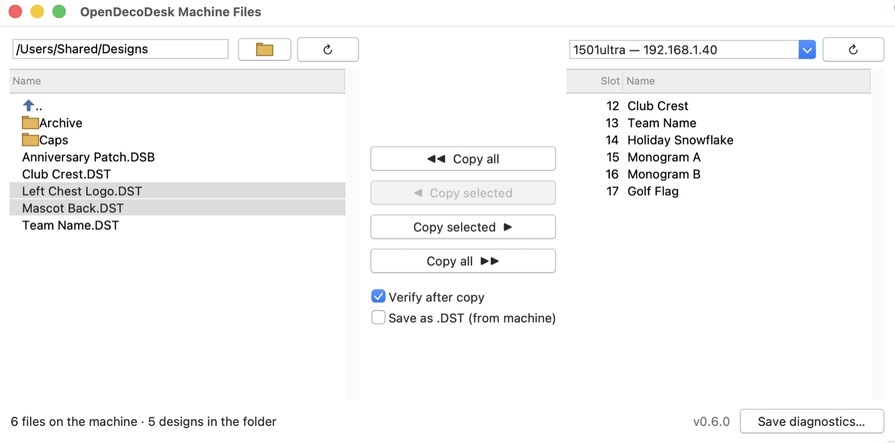

# OpenDecoDesk Machine Files

A small desktop app for copying embroidery designs between a folder on your computer and a
**SmartStitch** embroidery machine on your network — no vendor software, no website, nothing to
install besides the app itself.



- **Left:** a folder (type a path and press Enter, or click the folder button). Only `.dst` and `.dsb` files are
  listed. The list updates by itself when files are added, changed or removed (checked every 2 seconds);
  ↻ beside the folder button reads it again straight away. The list starts with `..` (up a level) and the
  subfolders, then the design files: double-click `..` or a folder (or press Enter) to go there;
  Backspace also goes up.
- **Right:** the machines found on the network (↻ scans again) and the files on the one picked —
  its slot number and name.
- **The four buttons:** copy everything, or just the selected files, in either direction. A file
  that's already on the other side is skipped, never overwritten: on the machine, by name (ignoring
  the extension and the machine's slot number); in the folder, by name *in the format being saved* —
  with Save as .DST on, a `LOGO.DSB` already there doesn't stop `LOGO.DST` being made.
- **Verify after copy** (under the buttons, on by default): each file is read back afterwards and
  checked. Sent to a machine, it's compared stitch by stitch — the machine stores every design in its
  own format (its `.DSB` form, header rewritten), so the file itself always changes but the stitches,
  colour changes and size must not. Copied off a machine, it's read a second time and must match the
  saved file byte for byte.
- **Save as .DST (from machine)** (off by default): files copied off a machine are saved as Tajima
  `.DST` instead of the machine's `.DSB` — the same stitches, with every needle change or stop as a
  colour change (how a `.DST` tells a machine to pause). Long moves are split into jumps; trims, which a
  `.DST` can't hold, are dropped. With Verify on, each `.DST` is checked against the machine's copy.
- It remembers the last folder, the machine and the two tick boxes. The machine is remembered by its
  network card's MAC address, so it's still picked when its IP address changes.

### What works today
| | |
|---|---|
| Finding machines (UDP scan) | ✅ |
| Listing a machine's files | ✅ |
| Copying files **to** a machine | ✅ |
| Copying files **from** a machine | ✅ saved as `.DSB` — the machine keeps every design in its own form (a DST-style header with Barudan stitch records), whatever was sent — or converted to `.DST` with Save as .DST |
| Checking a copy (Verify after copy) | ✅ read back and compared stitch by stitch (to a machine) or byte for byte (from one) |
| Deleting files on a machine | ❌ disabled in the machines' firmware ([PROTOCOL.md §6](PROTOCOL.md)); clear files at the touchscreen |

Tested against the `1201plus` and `1501ultra` models.

### If no machines are found
When the network scan gets no reply, the app tries TCP port 6000 (the machines' file port) on every
address of the computer's networks and keeps the ones that answer like a machine. That gets through a
firewall that drops the scan's replies; it takes a few seconds. If that finds nothing either:
Click **Save diagnostics…** (bottom right) and send the file it saves. It holds the app's version, this
computer's network addresses, where the scan was sent and what came back, and on Windows the network
type (Public / Private), the firewall's state and any firewall rule for this app — nothing is sent
anywhere by the app itself. The usual causes: the computer isn't on the machines' network (e.g. a remote
PC reached over Remote Desktop), or a firewall blocks the machines' replies. The vendor's app can stay
open: this one uses its own port for the replies.

## Download
From the [Releases](../../releases) page:
- **Windows:** `OpenDecoDesk-Machine-Files-Windows.exe` — one portable file, no install. Windows Firewall
  will ask to allow it on private networks the first time it scans; allow it.
- **macOS (Apple Silicon):** unzip `OpenDecoDesk-Machine-Files-macOS-AppleSilicon.zip`. The app isn't
  signed yet, so the first time, right-click it → Open. macOS then asks to let it find devices on your
  local network; allow it. On an Intel Mac, run it from source (below).

## Run from source
Python 3.9 or newer with Tk (standard library only — nothing to `pip install`):
```bash
python3 -m machine_files
```
On macOS, use the python.org installer or Homebrew's Python with Tk added (`brew install python-tk`; its
Tk 9 works).
Not Apple's `/usr/bin/python3`: its Tk 8.5 is deprecated and draws the window wrongly on current macOS.
If Python's Tk window never appears and the command just waits (often after a run was force-quit), macOS
is showing a hidden "reopen windows?" question; turn that off for Python with
`defaults write org.python.python ApplePersistenceIgnoreState -bool YES`.

## Tests
```bash
python3 -m unittest discover -s tests -t . -v
```
The protocol tests run against stub machines on loopback that speak the real frame shapes
(`tests/stubs.py`); the window tests drive the real window with a fake machine and are skipped
where Tk or a display isn't available.

## Making a release
Push a tag like `v0.6.0` (and set the same version in `machine_files/__init__.py` and the spec file). CI
runs the tests, builds both apps and publishes them as a release.

## Build the apps yourself
```bash
python3 -m pip install pyinstaller
pyinstaller --noconfirm opendecodesk-machine-files.spec
```

## How it talks to the machines
Discovery is a UDP broadcast to port 23; everything else is framed TCP on port 6000
(`FA 01 <len> <body> <xor>`). [PROTOCOL.md](PROTOCOL.md) has the full, reverse-engineered
reference; `machine_files/protocol.py` is the implementation.

SmartStitch is the machine vendor's brand; this project isn't affiliated with or endorsed by them.

## Licence
[GNU AGPL-3.0](LICENSE).
